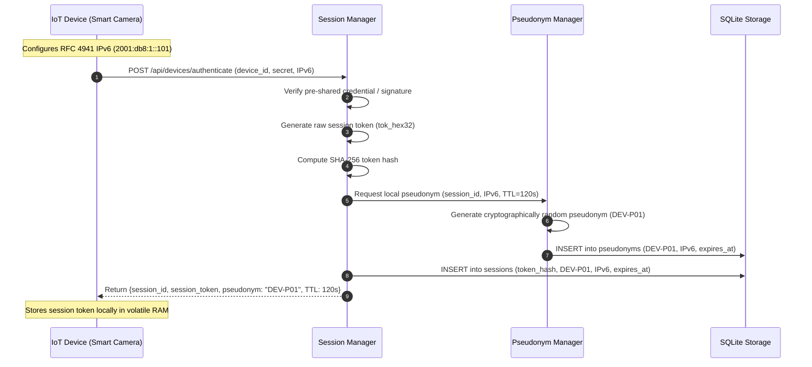
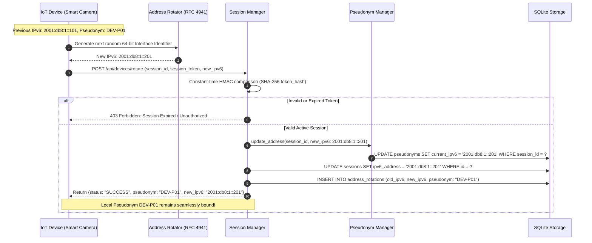
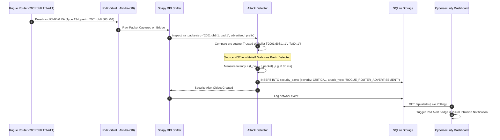
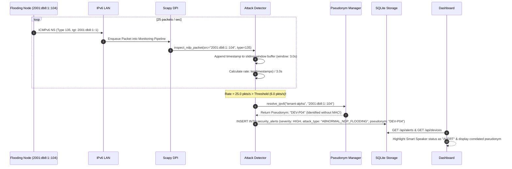
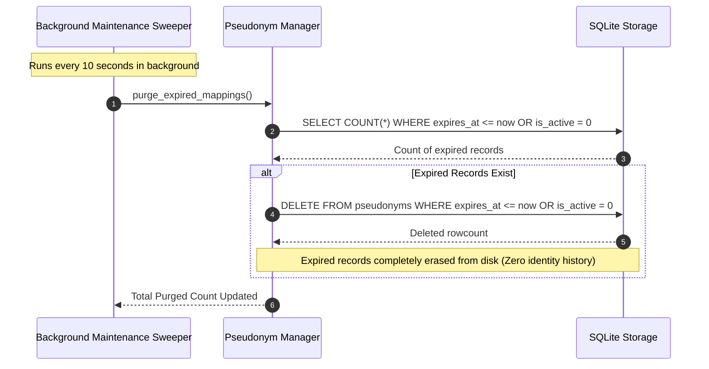

# Data Flow & Protocol Sequences: PS-007
## Privacy-Aware IPv6 IoT Security Monitoring Across Address Rotation

---

## 1. Initial Device Bootstrap & Ephemeral Pseudonym Assignment

When an IoT device boots, it configures a temporary SLAAC IPv6 address and initiates a mutual authentication handshake with the monitoring server.

---

## 2. RFC 4941 Address Rotation Handshake

When the device's temporary address rotation timer expires, the device rotates its address without exposing hardware identifiers.

---

## 3. Rogue Router Advertisement (RA) Detection Flow

An attacker virtual router broadcasts unauthorized ICMPv6 RA packets.

---

## 4. Abnormal NDP Flooding Detection & Pseudonym Correlation Flow

A compromised IoT device or attacker floods Neighbor Solicitations (NS).

---

## 5. Ephemeral Mapping Expiration & Secure Deletion Flow

Enforcing forward and backward unlinkability by deleting expired pseudonym records.

